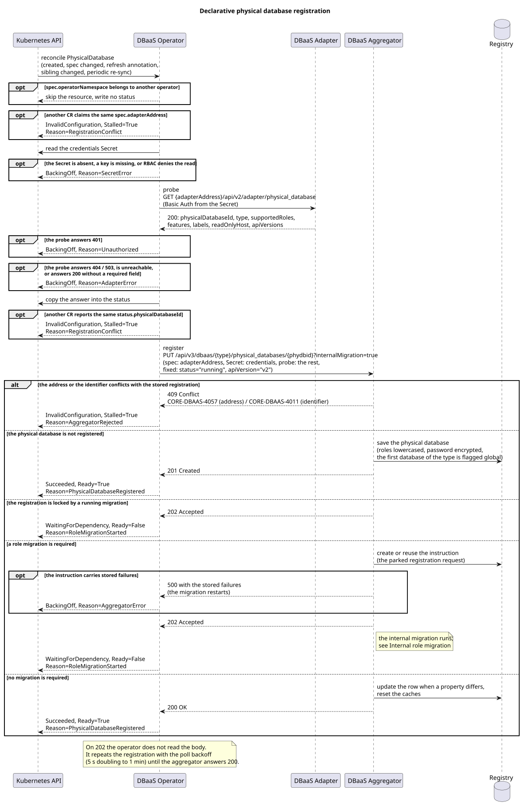
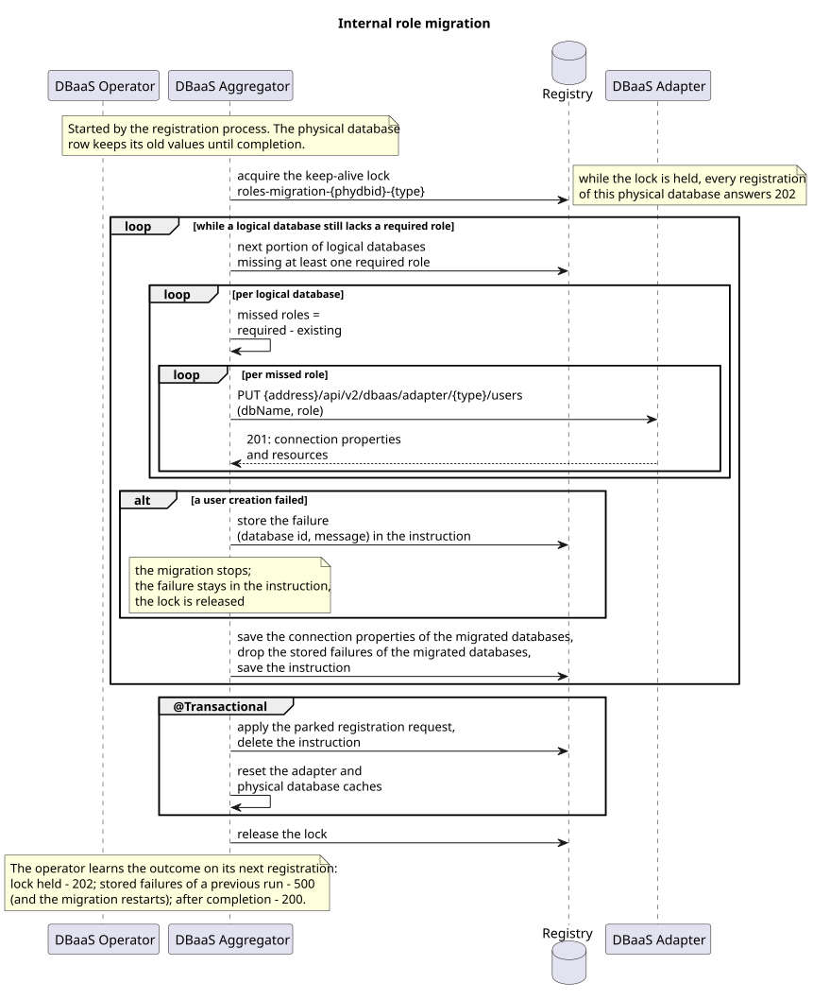

# Declarative Physical Database Registration: Design

This documentation includes design of the declarative physical database registration feature.
Defines behavior inside dbaas-operator and dbaas-aggregator and requirements for DBaaS adapters.

User-facing behavior lives in the [PhysicalDatabase resource page](../../../resources/physical-database.md), the
[status and troubleshooting page](../../../status-and-troubleshooting.md), and the [operator
parameters](../../../installation/parameters.md); this document explains the mechanism and the contract between
the components.

- [Goals](#goals)
- [Prerequisites](#prerequisites)
- [Sequence diagrams](#sequence-diagrams)
- [Behavior](#behavior)
    - [Reconcile triggers](#reconcile-triggers)
    - [Operator assignment](#operator-assignment)
    - [Conflict detection](#conflict-detection)
    - [Registration](#registration)
    - [Internal role migration](#internal-role-migration)
    - [Lifecycle](#lifecycle)
- [PhysicalDatabase resource](#physicaldatabase-resource)
- [Requirements for adapters](#requirements-for-adapters)
- [Configuration](#configuration)
- [Related](#related)

## Goals

Declarative physical database registration replaces the adapter-side self-registration:

- The registration is declared in Kubernetes as a `PhysicalDatabase` resource and owned by the dbaas-operator
  instead of running in an adapter loop. The adapter no longer calls the aggregator to register itself.
- The adapter reports its physical database through one read-only descriptor endpoint, instead of pushing
  registration requests periodically.
- When the adapter's role set changes, the migration of the existing logical databases to the new roles runs
  inside dbaas-aggregator, instead of being driven by the adapter through the `additional-roles` endpoint.

## Prerequisites

- The adapter and the DBMS cluster it manages already run. Neither the operator nor the aggregator installs them.
- The adapter implements the descriptor endpoint and the user-creation endpoint the role migration uses. See
  [Requirements for adapters](#requirements-for-adapters).
- The dbaas-operator is installed with the `PhysicalDatabase` CRD.
- The adapter side deploys the `PhysicalDatabase` resource, the credentials Secret, and the Role with the
  RoleBinding that grants the operator's ServiceAccount read access to the Secret, per the
  [deployment requirements](#deployment-requirements). Without the grant the resource fails with `forbidden`.

## Sequence diagrams

Below are the sequence diagrams of the physical database registration and internal migration

### Register a physical database



Source: [`register-physical-database.puml`](diagrams/register-physical-database.puml)

- **The identifier conflict check is performed after the probe**, because the identifier is known only from the
  adapter's answer. The address conflict is checked first, before even the Secret is read, so a misnamed resource
  fails
  fast without credentials.
- **The `201` branch flags the first database of a type as `global`** — the balancing default. The flag is
  computed at creation only; it moves with the `PUT /{phydbid}/global` endpoint, and a `global` physical database
  with siblings cannot be deleted until the flag is moved.
- **`202` ends the reconcile without an error and without advancing `observedGeneration`**: the registration is
  parked until the migration completes, and the operator learns the outcome only by repeating the registration.
- **The `500` branch** is the previous run's failures stored in the instruction. It is transient: the migration
  restarts in the same response, and the next registration while the lock is held answers `202`.

### Internal role migration

The aggregator-side loop that runs after a registration starts the migration.



Source: [`internal-role-migration.puml`](diagrams/internal-role-migration.puml)

- **The plan is not persisted.** Each pass re-queries the databases that still lack a required role, so an
  interrupted or failed cycle covers fewer databases on the retry, and there is nothing to empty.
- **The portion is committed before the next one starts.** The connection properties of the migrated databases
  are saved per portion, so a failure mid-cycle keeps the work already done.
- **Completion is one transaction**: the parked request is applied, the instruction is deleted, and the caches
  are reset together; the lock is released only after that. Until then every registration of the physical
  database answers `202`.

## Behavior

### Reconcile triggers

A reconcile runs when:

- the resource is created;
- the spec changes;
- the `dbaas.netcracker.com/refresh` annotation changes — a manual re-sync that does not touch the spec;
- another `PhysicalDatabase` that claims the same `adapterAddress` or `physicalDatabaseId` is created, deleted,
  or changes either of those — the sibling-conflict recovery;
- a periodic re-sync: every successful reconcile re-queues itself after `DBAAS_PHYSICAL_DATABASE_RESYNC_INTERVAL`
  (default `10m`). The operator does not watch Secrets, so the re-sync is what picks up a rotated adapter password
  and restores a registration row changed outside the resource.

### Operator assignment

The operator reconciles the resource only when `spec.operatorNamespace` equals its own namespace (`CLOUD_NAMESPACE`);
otherwise it skips the resource without a status or an event. Several operators can share a
cluster this way.

Unlike the other seven resources that carry `operatorNamespace`, `PhysicalDatabase` does not make it immutable:
there is no immutability rule on the field, so a wrong value can be corrected in place.

### Conflict detection

The aggregator keeps one row per identifier and one row per address, so two resources describing the same
adapter or the same cluster would collide on every re-sync. The operator therefore rejects the younger of two
conflicting resources:

- **One `adapterAddress` per operator.** Checked before the Secret read, through a field index over
  `spec.adapterAddress`.
- **One `physicalDatabaseId` per operator.** Checked after the probe, through a field index over
  `status.physicalDatabaseId` — the identifier is known only from the adapter's answer.
- Siblings are compared across all namespaces, but only within one `operatorNamespace`.

**An `adapterAddress` conflict stalls the younger resource.** The older claimant wins, by `creationTimestamp`
and then by UID. The younger one stalls with `InvalidConfiguration`, `Stalled=True`, reason
`RegistrationConflict`, and does not retry until the spec changes. The sibling watch re-enqueues it when the
older claimant is deleted or changes its claim, so the conflict resolves without a spec edit.

The aggregator enforces the same uniqueness on its side and answers `409` when the request contradicts a stored
row: `CORE-DBAAS-4057` when the identifier is registered under another address, `CORE-DBAAS-4011` when the address
is registered under another identifier. The two are handled differently:

- **`4057` is a spec rejection.** The address comes from `spec.adapterAddress`, so only a spec change resolves it:
  `InvalidConfiguration`, `Stalled=True`, reason `AggregatorRejected`.
- **`4011` is transient.** The identifier comes from the adapter and can return to the registered value without
  any change to the resource, so the operator keeps retrying: `BackingOff`, `Stalled=False`, reason
  `PhysicalDatabaseIdConflict`, on the poll backoff, with a Warning event on every attempt. Once the conflict has
  lasted more than 30 minutes the reason becomes `PhysicalDatabaseIdConflictTimeout`, one Warning event records
  the crossing, and the operator retries every `DBAAS_PHYSICAL_DATABASE_RESYNC_INTERVAL` without further events.
  Any other answer clears `status.firstIdConflictAt`, so a later conflict starts a fresh streak.

An aggregator before 6.18.0 answers both conflicts with `CORE-DBAAS-4011`, so the operator retries an address
conflict as well instead of stalling it.

### Registration

The operator assembles the aggregator registration request from the spec, the probe answer, and the Secret:

`PUT /api/v3/dbaas/{type}/physical_databases/{phydbid}?internalMigration=true`

where `{type}` and `{phydbid}` are the probe's `type` and `physicalDatabaseId`.

| Request field                                 | Value                                       | Source                                                                      |
|-----------------------------------------------|---------------------------------------------|-----------------------------------------------------------------------------|
| `{type}` path segment                         | The database engine type, e.g. `postgresql` | The probe (`type`)                                                          |
| `{phydbid}` path segment                      | The adapter-assigned identifier             | The probe (`physicalDatabaseId`)                                            |
| `adapterAddress`                              | The adapter base URL                        | `spec.adapterAddress`                                                       |
| `httpBasicCredentials.username` / `.password` | The adapter's Basic Auth pair               | The credentials Secret                                                      |
| `labels`                                      | The physical database labels                | The probe (`labels`)                                                        |
| `metadata.apiVersion`                         | Always `v2`                                 | The operator                                                                |
| `metadata.apiVersions`                        | The adapter's API contract                  | The probe (`apiVersions`)                                                   |
| `metadata.supportedRoles`                     | The roles the adapter can create            | The probe (`supportedRoles`); the aggregator lowercases them before storing |
| `metadata.features`                           | The feature flags                           | The probe (`features`)                                                      |
| `metadata.roHost`                             | The read-only host of the cluster           | The probe (`readOnlyHost`)                                                  |
| `status`                                      | Always `running`                            | The operator — `running` skips the aggregator handshake                     |
| `internalMigration` query parameter           | `true`                                      | The operator — the migration runs inside the aggregator                     |

The fixed `status: "running"` matters: with it the aggregator does not call the adapter's handshake endpoint,
because the operator has already probed the adapter itself.

**The aggregator decides:**

| Response                       | When                                                                                                                                                                                                                            | Operator result                                                                                |
|--------------------------------|---------------------------------------------------------------------------------------------------------------------------------------------------------------------------------------------------------------------------------|------------------------------------------------------------------------------------------------|
| `201 Created`                  | Nothing is registered under the identifier or the address. Roles are lowercased, the password is encrypted, and the first database of the type is flagged `global`                                                              | `Succeeded`, `Ready=True`, reason `PhysicalDatabaseRegistered`                                 |
| `200 OK`                       | The physical database is registered and no migration is required. The row is rewritten only when a property differs from the stored one (`isDbActual`), which resets the cached adapter client and the cached physical database | `Succeeded`, `Ready=True`, reason `PhysicalDatabaseRegistered`                                 |
| `202 Accepted`, empty body     | A role migration holds the registration lock, or a migration is starting                                                                                                                                                        | `WaitingForDependency`, reason `RoleMigrationStarted`; the operator polls                      |
| `500` with the stored failures | A migration is required and the instruction carries the failures of a previous run. The migration restarts                                                                                                                      | `BackingOff`, reason `AggregatorError`                                                         |
| `409` `CORE-DBAAS-4057`        | The identifier is registered under a different address, and the change is not a scheme change on the same host                                                                                                                  | `InvalidConfiguration`, `Stalled=True`, reason `AggregatorRejected`                            |
| `409` `CORE-DBAAS-4011`        | The address is already registered under a different identifier                                                                                                                                                                  | `BackingOff`, `Stalled=False`, reason `PhysicalDatabaseIdConflict`; the operator keeps polling |
| `400`                          | A migration is required, but `status` is not `running` or `metadata.apiVersion` is not `v2`. Unreachable for the operator, which always sends both                                                                              | `InvalidConfiguration`, `Stalled=True`, reason `AggregatorRejected`                            |
| `401`                          | The operator's aggregator credentials are missing or invalid                                                                                                                                                                    | `BackingOff`, reason `Unauthorized`                                                            |

`isDbActual` compares the adapter address, the Basic Auth username, the password (decrypted), the labels,
`apiVersion`, `apiVersions`, the roles (ignoring case and order), the features, and `roHost`. A `200` therefore
writes nothing when the probe answer matches the stored row — which is also why an unchanged resource is cheap
to re-sync.

The `400 CORE-DBAAS-4045` for an address without a host or a scheme is unreachable in this flow: the CRD pattern
on `spec.adapterAddress` rejects such a value at admission.

### Internal role migration

The migration starts when three conditions hold together: the reported `supportedRoles` differ from the stored
roles (compared ignoring case and order), the reported `features.multiusers` is `true`, and at least one logical
database of the physical database lacks a required role.

The registration request that starts the migration is not applied. It is parked in a `physical_database_instruction`
row of type `MULTIUSERS_MIGRATION`, and the physical database row is left untouched until the migration
completes. An instruction row from a previous, unfinished cycle is reused: the cycle completes with the parked
request, not with the latest one.

The aggregator takes a keep-alive lock named `roles-migration-{phydbid}-{type}` so that one replica runs the
migration. While the lock is held, every registration of this physical database answers `202`.

The migration runs asynchronously in portions of 50 logical databases. Each pass re-queries the logical
databases that still lack a required role, so a retried cycle covers fewer of them. For every database of a
portion the aggregator computes the missed roles (required minus existing) and calls the adapter once per
missed role: `PUT {adapterAddress}/api/v2/dbaas/adapter/{type}/users` with the database name and the role.
After each portion the aggregator:

- saves the returned connection properties and resources to the logical databases;
- drops the stored failures of the databases migrated in the portion;
- saves the instruction.

A failed user creation stops the migration and stores the failure (the database id and the message) in the
instruction. The next registration while the migration is still required answers `500` with the stored failures
and restarts the migration; the already migrated databases are skipped because the plan is re-queried.

On completion the aggregator, in a single transaction, applies the parked registration request to the physical
database row (always, without the `isDbActual` comparison), deletes the instruction, and resets the cached
adapter client and the cached physical database. Only then is the lock released.

The operator does not read the `202` body. It repeats the registration with the poll backoff — 5 s doubling to
1 min, with up to 10% jitter — until the aggregator answers `200`. The polling sequence is per resource and
resets on a spec change, a successful registration, or an operator restart. A `500` instead is retried with the
regular reconcile backoff. `status.observedGeneration` stays behind `metadata.generation` for the whole time the
migration runs.

**The legacy path stays.** Without `internalMigration` the aggregator answers `202` with the first portion and
the adapter drives the continuation through
`POST /api/v3/dbaas/{type}/physical_databases/{phydbid}/instruction/{instructionid}/additional-roles`. Self
registering adapters keep using that path; the operator never does.

### Lifecycle

- **The registration outlives the resource.** The operator never calls the aggregator `DELETE`; deleting the
  `PhysicalDatabase` only stops managing the registration.
- **A row changed outside the resource is restored** on the next re-sync, because the re-sync re-sends the
  registration built from the spec, the Secret, and a fresh probe.
- **The accepted address change is a scheme change on the same host**, for example `http` to `https`. A
  port-only change or a host change is `409 CORE-DBAAS-4057` and stalls the resource.
- **A rotated adapter password** is picked up by the next re-sync, or immediately by changing the
  `dbaas.netcracker.com/refresh` annotation.
- **A changed `supportedRoles`** starts the internal migration when `multiusers` is `true`; the resource stays
  `WaitingForDependency` until the aggregator answers `200`.

## PhysicalDatabase resource

`PhysicalDatabase` declares a physical database (a DBMS cluster plus its dbaas adapter) that dbaas-aggregator
should know about. The operator does not install the adapter or the DBMS — both must already be running.

```yaml
# The adapter's own Basic Auth credentials; must be in the same namespace as the resource
apiVersion: v1
kind: Secret
metadata:
  name: dbaas-adapter-credentials
  namespace: dbaas-db-adapters
type: Opaque
stringData:
  username: "dbaas-aggregator"
  password: "<adapter-password>"
---
apiVersion: dbaas.netcracker.com/v1
kind: PhysicalDatabase
metadata:
  name: postgres-core
  namespace: dbaas-db-adapters
spec:
  operatorNamespace: dbaas-system
  adapterAddress: http://pg-dbaas-adapter.postgres:8080
  credentialsSecretRef:
    name: dbaas-adapter-credentials
```

**Spec fields:**

| Field                            | Required | Mutable | Description                                                                                                                                                                                                                                                                                             |
|----------------------------------|:--------:|:-------:|---------------------------------------------------------------------------------------------------------------------------------------------------------------------------------------------------------------------------------------------------------------------------------------------------------|
| `spec.operatorNamespace`         |   Yes    |   Yes   | The namespace of the operator instance that owns the resource; must equal that operator's `CLOUD_NAMESPACE`. An RFC-1123 label, `maxLength: 63`. Unlike the other seven resources, the field carries no immutability rule, so a wrong value can be corrected in place.                                  |
| `spec.adapterAddress`            |   Yes    |   Yes   | The adapter base URL, sent as `adapterAddress`. Must match `^[^\s:/?#]+://[^\s/?#]+`: a scheme, `://`, and a non-empty host. The aggregator accepts a change only when the host is unchanged and the scheme differs, so `http://a:8080` to `https://a:8443` passes while a port-only change is a `409`. |
| `spec.credentialsSecretRef.name` |   Yes    |   Yes   | The Secret in the resource's namespace with the adapter's own Basic Auth credentials. The operator reads the fixed keys `username` and `password`.                                                                                                                                                      |

**Status fields:**

The operator embeds the common `OperatorStatus` — `phase`, `observedGeneration`, `conditions`, `lastRequestId` —
and adds `firstIdConflictAt` and the adapter's answer of the last successful probe. A later failed probe leaves
the adapter fields as they are:

| Field                       | Copied from the probe as | Sent to the aggregator as    |
|-----------------------------|--------------------------|------------------------------|
| `status.physicalDatabaseId` | `physicalDatabaseId`     | the `{phydbid}` path segment |
| `status.type`               | `type`                   | the `{type}` path segment    |
| `status.labels`             | `labels`                 | `labels`                     |
| `status.supportedRoles`     | `supportedRoles`         | `metadata.supportedRoles`    |
| `status.features`           | `features`               | `metadata.features`          |
| `status.readOnlyHost`       | `readOnlyHost`           | `metadata.roHost`            |
| `status.apiVersions`        | `apiVersions`            | `metadata.apiVersions`       |

The status schema carries no validation rules, so a rejected status write cannot drop the conditions.
`status.firstIdConflictAt` is not copied from the probe: it records when the current `CORE-DBAAS-4011`
conflict streak started, and any other answer clears it. The `observedGeneration` advances only when
reconciliation reaches a terminal state for the current generation (`Ready=True` or `Stalled=True`); while a
role migration or an identifier conflict runs it stays behind.

## Requirements for adapters

The operator calls the descriptor endpoint with the Basic Auth pair from the credentials Secret. The request
times out after 30 seconds and is not retried. The endpoints this feature needs from the adapter, as defined by
the [adapter contract](../../../../../docs/api/adapter-contract.yaml):

| Operation                        | Endpoint                                 | Used for                                                                    |
|----------------------------------|------------------------------------------|-----------------------------------------------------------------------------|
| `getPhysicalDatabaseInformation` | `GET /api/v2/adapter/physical_database`  | The operator probe: the physical database descriptor                        |
| `ensureUser`                     | `PUT /api/v2/dbaas/adapter/{type}/users` | The internal role migration: one call per missed role of a logical database |

### The descriptor endpoint

`GET /api/v2/adapter/physical_database` answers with the physical database descriptor ([
`PhysicalDatabaseInformation`](../../../../../docs/api/adapter-contract.yaml)). It takes no path parameters —
the type is part of the answer, not the request. It authenticates with the same Basic Auth pair the aggregator
uses to call the adapter, because the operator reads that pair from the credentials Secret and uses it for the
probe.

Example answer:

```json
{
  "physicalDatabaseId": "postgresql-core",
  "type": "postgresql",
  "labels": {
    "clusterName": "postgres-core"
  },
  "apiVersions": {
    "specs": [
      {
        "specRootUrl": "/api",
        "major": 2,
        "minor": 1,
        "supportedMajors": [
          2
        ]
      }
    ]
  },
  "features": {
    "multiusers": true
  },
  "supportedRoles": [
    "admin",
    "rw",
    "ro"
  ],
  "readOnlyHost": "pg-patroni-ro.postgres"
}
```

| Field                | Required | Notes                                                                                                                                                        |
|----------------------|:--------:|--------------------------------------------------------------------------------------------------------------------------------------------------------------|
| `physicalDatabaseId` |   Yes    | The adapter-assigned identifier of the cluster. It becomes the `{phydbid}` path segment, the aggregator's registration key, and the operator's conflict key. |
| `type`               |   Yes    | The database engine type, e.g. `postgresql`. It becomes the `{type}` path segment.                                                                           |
| `supportedRoles`     |   Yes    | Non-empty. The roles the adapter can create for logical databases.                                                                                           |
| `features`           |   Yes    | Must carry the `multiusers` key. `multiusers: true` is what allows the internal migration to run.                                                            |
| `apiVersions`        |   Yes    | The adapter's API contract, per the adapter contract.                                                                                                        |
| `labels`             |    No    | Passed through to the registry.                                                                                                                              |
| `readOnlyHost`       |    No    | Passed to the registry as `roHost` and added to the connection properties of the logical databases.                                                          |

Adapter response semantics:

| Answer                                         | Meaning                                                                                            | Operator behaviour                                 |
|------------------------------------------------|----------------------------------------------------------------------------------------------------------------------|----------------------------------------------------|
| `200`                                          | Served with every required field                                                                                     | Copied into the status; the registration continues |
| `401`                                          | The Basic Auth pair does not match the adapter's                                                                     | `BackingOff`, reason `Unauthorized`                |
| `404`                                          | The endpoint is not implemented                                                                                      | `BackingOff`, reason `AdapterError`                |
| `503`                                          | The adapter is not ready yet                                                                                         | `BackingOff`, reason `AdapterError`                |
| Unreachable, or `200` without a required field | No answer, or an answer missing `physicalDatabaseId`, `type`, a non-empty `supportedRoles`, or `features.multiusers` | `BackingOff`, reason `AdapterError`                |

A failed probe is transient, because a restarting adapter may answer correctly on the next one.

### Behavioral requirements

- **A stable `physicalDatabaseId`.** The value belongs to the database cluster and must not change on restarts
  or adapter upgrades. The aggregator checks uniqueness in both directions: the identifier may be registered
  under one address only, and an address may be registered under one identifier only.
- **The reported roles and features are the source of the migration.** When `supportedRoles` changes while
  `multiusers` is `true`, the aggregator migrates every existing logical database to the new roles by calling
  the adapter's user-creation endpoint.
- **`labels` and `readOnlyHost` are pass-through.** They are stored in the registry and returned in the
  connection properties of the logical databases; the aggregator does not interpret them.

### Deployment requirements

The feature is deployed on the adapter side. The adapter's Helm chart deploys in the adapter's namespace,
together with the adapter:

| Artifact                      | Purpose                                                                                                                                  |
|-------------------------------|------------------------------------------------------------------------------------------------------------------------------------------|
| The credentials Secret        | The adapter's Basic Auth pair; the operator reads it for the probe and sends it to the aggregator                                        |
| The PhysicalDatabase resource | Declares the adapter address and the Secret reference (see the [PhysicalDatabase resource](#physicaldatabase-resource) section)          |
| A Role and a RoleBinding      | Grant the operator's ServiceAccount read (`get`) access to the credentials Secret. Without the grant the resource fails with `forbidden` |

The RoleBinding subject is the operator's ServiceAccount (`dbaas-operator` by default) in the operator's
namespace, so the chart carries the operator namespace and the ServiceAccount name as values. The operator
creates neither object. For the `PhysicalDatabase` Secret the operator only reads, so `get` is the only verb
the Role needs. The [sample](../../../../config/samples/namespaced-secret-rbac.yaml) shows the grant's shape,
and the operator's [installation docs](../../../installation/installation.md#secret-access) document it.

### What the adapter stops doing

The feature removes the adapter's registration loop. An adapter that moves to declarative registration:

| Was used for                                       | Endpoint                                                                                                                                              | Now                                                                                               |
|----------------------------------------------------|-------------------------------------------------------------------------------------------------------------------------------------------------------|---------------------------------------------------------------------------------------------------|
| The periodic self-registration and re-registration | `PUT /api/v3/dbaas/{type}/physical_databases/{phydbid}`, sent by the adapter itself with `status: running` after startup and `status: run` afterwards | The operator sends the registration; the adapter must not send it                                 |
| Driving the role migration                         | `POST /api/v3/dbaas/{type}/physical_databases/{phydbid}/instruction/{instructionid}/additional-roles`                                                 | The aggregator runs the migration internally and calls the adapter per user                       |

**If self-registration is left on, the registration churns.** The adapter loop and the operator both `PUT` their
own view of the same row. Every write makes the other writer's `isDbActual` comparison fail, so the row is
rewritten and the adapter caches are reset on every cycle of both writers.

## Configuration

| Parameter                              | Setting                                        | Default     | Description                                                                                     |
|----------------------------------------|------------------------------------------------|-------------|-------------------------------------------------------------------------------------------------|
| The physical database re-sync interval | `DBAAS_PHYSICAL_DATABASE_RESYNC_INTERVAL`      | `10m`       | How often each `PhysicalDatabase` re-reads its Secret and registers again                       |
| The reconcile backoff                  | `--backoff-base-delay` / `--backoff-max-delay` | `1s` / `5m` | The retry delay after a failed reconcile, such as an aggregator `500` or an unreachable adapter |

The poll backoff after a `202` is fixed: 5 s doubling to 1 min, with up to 10% jitter. See the [operator
parameters](../../../installation/parameters.md) for the full list and the [reconcile
backoff](../../../status-and-troubleshooting.md#reconcile-backoff) for the semantics.

## Related

- [PhysicalDatabase resource](../../../resources/physical-database.md) — the user-facing resource reference
- [Status and troubleshooting](../../../status-and-troubleshooting.md) — phases, conditions, reasons, events
- [Operator parameters](../../../installation/parameters.md) — the settings above
- [Adapter contract](../../../../../docs/api/adapter-contract.yaml) — the descriptor and user-creation endpoints
- [Aggregator contract](../../aggregator-contract.md) — the operator-to-aggregator endpoints
- [REST API reference](../../../../../docs/api/rest-api.md) — the registration endpoint
