# Backup & Restore V2: Design

Internal design of the Backup & Restore V2 feature: behavior inside dbaas-aggregator, the data model, the
diagrams, and the requirements the feature imposes on DBaaS Adapters and on the aggregator itself.

User-facing behavior and API usage live in the [Backup & Restore V2 how-to](../howto/Backup%20and%20Restore%20V2.md);
this document explains the mechanism and the contract between components.

- [Goals](#goals)
- [Architecture](#architecture)
- [Behavior](#behavior)
    - [Filtering](#filtering)
    - [External databases](#external-databases)
    - [Non-backupable databases](#non-backupable-databases)
    - [Mapping and classifier replacement](#mapping-and-classifier-replacement)
    - [Dry run](#dry-run)
    - [Restore lock](#restore-lock)
    - [Retries and the scheduler](#retries-and-the-scheduler)
    - [Aggregation](#aggregation)
- [Data model](#data-model)
- [Sequence diagrams](#sequence-diagrams)
- [State diagrams](#state-diagrams)
- [Requirements for adapters](#requirements-for-adapters)
- [Requirements for the aggregator](#requirements-for-the-aggregator)
- [Configuration](#configuration)

## Goals

Backup & Restore V2 answers the following requirements:

- Flexible backup scope: back up a namespace or several microservices, not only a fixed set.
- Flexible restore scope: restore a full backup or a part of it, into another namespace and/or tenant.
- Backup/restore portability: restore a backup in another DBaaS instance.

## Architecture

In the end-to-end process, DBaaS is one component of several. Cloud Backuper orchestrates the overall backup and
restore; DBaaS receives the commands, determines which databases they cover, and calls the DBaaS Adapter of each
database type. The adapter delegates the actual work to the Backup Daemon, which stores the binary payload in an
S3-compatible object storage.

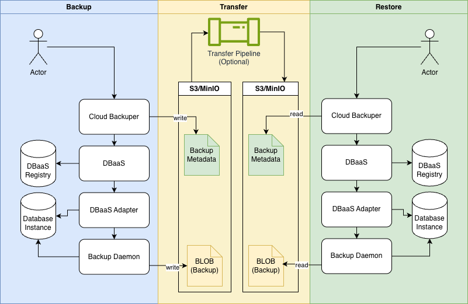

Key properties of the design:

- DBaaS is a registry, not a data mover. It resolves the selection from its own registry, aggregates the adapter
  results, and persists the operation state. It never touches the payload.
- The payload location is named by the caller (`storageName` and `blobPath`) and passed through to the adapters.
- The backup structure is exported as metadata (a `BackupResponse` with a SHA-256 digest). With the metadata and
  the payload in a shared or copied object storage, the same logical databases can be restored in any DBaaS
  environment where the required adapters are available.
- The caller chooses a unique `backupName` for the backup request. The backup process registers the backup under
  that name (left side of the diagram); restore operations reference the backup by that name (right side).

## Behavior

### Filtering

Backup requests carry `filterCriteria` with `include` and `exclude` lists. The matching rules:

- Include: a registry is selected when it matches at least one filter in `include` (OR across filters). Within one
  filter, every filled field must match (AND across fields); empty fields are ignored.
- Exclude: after the include stage, any registry that matches at least one filter in `exclude` is removed, with the
  same OR/AND rules.
- Validity: before matching, registries marked for deletion are dropped, and internal registries must be in the
  `CREATED` state. External registries are not subject to the state check.

Fields a filter may carry: `namespace`, `microserviceName`, `databaseType`, `databaseKind`. `databaseKind` matches
on the blue-green flag: `CONFIGURATION` matches databases with a `bgVersion`, `TRANSACTIONAL` matches those
without.

For restore requests the same rules apply to the databases stored in the backup metadata, not to the registry.
`filterCriteria` is optional there: a null or empty filter selects every database of the backup.

### External databases

Databases that pass the filters are split into internal (managed by DBaaS) and external (externally manageable)
groups. The `externalDatabaseStrategy` decides what happens to the external group:

| Strategy  | Effect                                                                                                         |
|-----------|----------------------------------------------------------------------------------------------------------------|
| `FAIL`    | The request is rejected with 400, naming the external databases                                                |
| `SKIP`    | The external group is excluded from the operation                                                              |
| `INCLUDE` | External databases are recorded in the backup and included in a restore when the restore strategy is `INCLUDE` |

### Non-backupable databases

An internal database is not backupable when it is disabled for backup (`backupDisabled=true`) or its adapter does
not support backup/restore. The request field `ignoreNotBackupableDatabases` (default `false`) switches between
failing with 400, naming the databases, and excluding them from the backup.

### Mapping and classifier replacement

A restore request may carry `mapping` with `namespaces` and `tenants` maps (source to target). The mapping rewrites
the classifier values of every selected database before the restore, for internal and external databases alike.
The pre-mapping classifier is preserved in `classifierBeforeMapper` for the audit trail.

After mapping, DBaaS enriches each selected database's classifiers on the restore structure against the target registry
and assigns a `ClassifierType` to each:

| Type                 | Meaning                                                                                                                                                                                     |
|----------------------|---------------------------------------------------------------------------------------------------------------------------------------------------------------------------------------------|
| `NEW`                | No database in the target environment has this classifier                                                                                                                                   |
| `REPLACED`           | A logical database with this classifier already exists; the restored database takes the classifier, the existing one is marked as an orphan, and its name is recorded in `previousDatabase` |
| `TRANSIENT_REPLACED` | The same physical database as a `REPLACED` classifier also carries other classifiers; those logical databases are marked as orphans as well                                                 |

The `ClassifierType` is restore-time metadata: it drives the orphan marking of replaced databases during finalization
and is
reported in the restore response. The logical databases created in the target environment carry only the plain
classifier maps, without the type or the `previousDatabase` reference.

A collision check runs over all mapped classifiers of the operation. If two of them end up identical, the restore
is rejected with 409 before any adapter is called.

### Dry run

- Backup dry run (`?dryRun=true`): DBaaS resolves the selection and builds the full in-memory `Backup` structure,
  but persists nothing and calls no adapter. The response is the structure the real backup would create.
- Restore dry run (`?dryRun=true`): DBaaS builds the restore structure, runs the validation (including the
  collision check), and calls each adapter in dry-run mode. No DBaaS state is persisted and no adapter change is
  applied.

A non-dry-run restore first runs the adapter dry run for every logical restore; only if that succeeds does it call
the real restore.

### Restore lock

Only one restore runs at a time. DBaaS acquires an expirable lock around restore initialization, and rejects the
operation with 409 when the lock is held or when restores in a non-terminal state exist. The internal endpoint
`POST /api/backups/v1/backup/{backupName}/restore/allowParallel` skips the lock; it exists for testing parallel
restores and is hidden from the public API.

### Retries and the scheduler

- A scheduler scans backups and restores in `IN_PROGRESS` on the check interval (see [Configuration](#configuration)),
  tracks them through the adapters, and aggregates the result. A distributed lock ensures that one replica
  executes each pass.
- A single failed adapter call is retried with the configured attempt count and delay (see
  [Configuration](#configuration)).
- Each tracking pass increments the operation's `attemptCount`. When it reaches the configured maximum, the
  operation is marked `FAILED`.
- A retry (`POST /api/backups/v1/restore/{restoreName}/retry`) resets the attempt counter, sets the restore back
  to `IN_PROGRESS`, and resets the failed or not-started logical restores to `RETRYABLE_FAIL` with a null
  `logicalRestoreName`.

### Aggregation

After every adapter response (initial, tracking, retry) the service aggregates the whole operation:

- Backup: the `LogicalBackup` statuses are collapsed into the `Backup` status, the database count and payload size
  are summed, the completed count is updated, and the per-adapter error messages are joined with `"; "` into
  `errorMessage`. External databases count into `total` and `completed` from the start.
- Restore: the same over `LogicalRestore` and `RestoreDatabase`. A returned database that is not present in the
  current restore list marks the logical restore `FAILED` with a warning log.

Restore finalization (after the last adapter reports completion): the service ensures all required users exist in
the target databases via the adapter (`ensureUser`, with retries), marks replaced databases as orphans, creates the
logical databases with their classifiers, settings, and users, fills connection properties, encrypts the
credentials, and sets the restore to `COMPLETED`.

## Data model

### Backup V2 Data Model

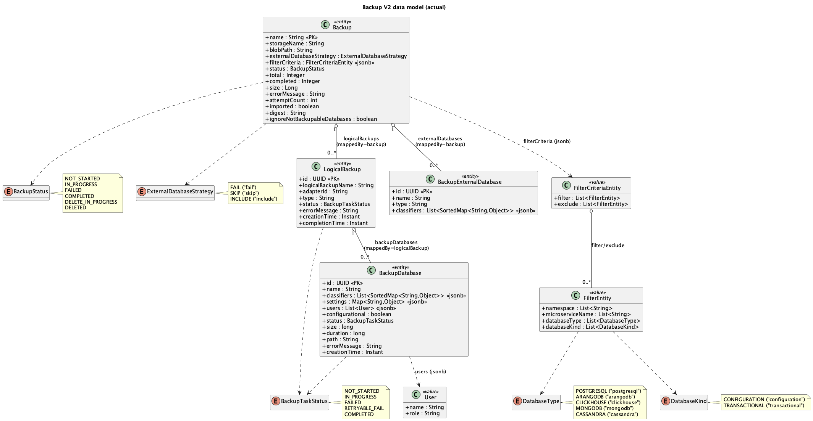

Source: [`backup-v2-data-model.puml`](../diagrams/backup-and-restore-v2/backup-v2-data-model.puml)

#### Backup

Backup is the top-level backup operation entity that stores the requested filters and strategy plus the aggregated
state of the backup (status, totals, size, errors) and links to all logical and external database backups.

| Field                        | Type                         | Description                                                                                                                                                          | Source                                     |
|------------------------------|------------------------------|----------------------------------------------------------------------------------------------------------------------------------------------------------------------|--------------------------------------------|
| name                         | String                       | Unique name of the backup                                                                                                                                            | BackupRequest.backupName                   |
| storageName                  | String                       | Name of the storage backend containing the backup                                                                                                                    | BackupRequest.storageName                  |
| blobPath                     | String                       | Path in the storage where backup will be stored                                                                                                                      | BackupRequest.blobPath                     |
| externalDatabaseStrategy     | ExternalDatabaseStrategy     | How to handle external databases during backup                                                                                                                       | BackupRequest.externalDatabaseStrategy     |
| filterCriteria               | FilterCriteriaEntity (jsonb) | Filter criteria                                                                                                                                                      | BackupRequest.filterCriteria               |
| logicalBackups               | List<LogicalBackup>          | Collection of logical backups grouped by adapter/database type; each entry contains its backup databases and tracks the progress/status of the backup for that group | -                                          |
| externalDatabases            | List<BackupExternalDatabase> | List of externally managed databases included in the backup (according to the external database strategy), with their names, types, and classifiers                  | -                                          |
| status                       | BackupStatus                 | Current state of the backup operation                                                                                                                                | -                                          |
| total                        | Integer                      | Total number of databases being backed up                                                                                                                            | -                                          |
| completed                    | Integer                      | Number of databases successfully backed up                                                                                                                           | -                                          |
| size                         | Long                         | Total size of the backup in bytes                                                                                                                                    | -                                          |
| errorMessage                 | String                       | Error details if the backup failed                                                                                                                                   | -                                          |
| attemptCount                 | int                          | Number of tracking/aggregation attempts made for this backup (used by the scheduler to limit retries)                                                                | —                                          |
| imported                     | boolean                      | Indicates that the backup metadata was imported from an external source (backup metadata) rather than created by a local backup operation                            | —                                          |
| digest                       | String                       | SHA-256 digest of the backup metadata, used to verify integrity during upload/import                                                                                 | —                                          |
| ignoreNotBackupableDatabases | boolean                      | Whether non-backupable databases were ignored during backup                                                                                                          | BackupRequest.ignoreNotBackupableDatabases |

#### LogicalBackup

Databases that pass the input filters and are identified as internal are grouped by adapterId; for each adapterId,
a LogicalBackup is created. Each LogicalBackup contains BackupDatabase entries for every database in that group
(name, classifiers, settings, users, configurational, etc.). In short, LogicalBackup is an aggregate for one
adapter's group of databases with its populated BackupDatabase list.

| Field             | Type                 | Description                                                 |
|-------------------|----------------------|-------------------------------------------------------------|
| id                | UUID                 | Auto-generated primary key                                  |
| logicalBackupName | String               | Name of the logical backup in adapter                       |
| backup            | Backup               | Parent backup operation that this logical backup belongs to |
| adapterId         | String               | Unique identifier of the adapter                            |
| type              | String               | Type of the adapter                                         |
| backupDatabases   | List<BackupDatabase> | List of logical backup databases                            |
| status            | BackupTaskStatus     | Current state of the backup databases of one adapter        |
| errorMessage      | String               | Error message if backup failed                              |
| creationTime      | Instant              | Timestamp when the backup was created                       |
| completionTime    | Instant              | Timestamp when the backup completed                         |

#### BackupDatabase

BackupDatabase is a per-database backup record inside a LogicalBackup, containing the database identity
(name/classifiers), settings/users, and backup execution details (status, size, duration, path, errors,
timestamps).

| Field           | Type                           | Description                                                                  |
|-----------------|--------------------------------|------------------------------------------------------------------------------|
| id              | UUID                           | Auto-generated primary key                                                   |
| logicalBackup   | LogicalBackup                  | Parent logical backup that this database entry belongs to                    |
| name            | String                         | Name of the database                                                         |
| classifiers     | List<SortedMap<String,Object>> | List of database classifiers. Each classifier is a sorted map of attributes. |
| settings        | Map<String,Object>             | Database settings as a key-value map                                         |
| users           | List<User>                     | List of database users                                                       |
| configurational | boolean                        | Indicates the type of the database                                           |
| status          | BackupTaskStatus               | Current state of the backup database                                         |
| size            | long                           | Size of the backup                                                           |
| duration        | long                           | Duration of the backup operation                                             |
| path            | String                         | Path to the backup file in the storage                                       |
| errorMessage    | String                         | Error message if the backup failed                                           |
| creationTime    | Instant                        | Timestamp when the backup was created                                        |

#### BackupExternalDatabase

BackupExternalDatabase entries are created from databases that pass the input filters and are then identified as
external.

| Field       | Type                           | Description                                                                  |
|-------------|--------------------------------|------------------------------------------------------------------------------|
| id          | UUID                           | Auto-generated primary key                                                   |
| backup      | Backup                         | Parent backup operation that this external database belongs to               |
| name        | String                         | Name of the external database                                                |
| type        | String                         | Type of the database                                                         |
| classifiers | List<SortedMap<String,Object>> | List of database classifiers. Each classifier is a sorted map of attributes. |

#### FilterCriteriaEntity

Filtering uses FilterCriteria with include (filter) and exclude. A registry matches the include stage if it
satisfies at least one filter in filter (OR across filters), and within a single filter all provided fields must
match (AND across fields). After that, any registry that matches at least one filter in exclude is removed (OR
across exclude filters), with the same AND across fields rule inside each exclude filter.

| Field   | Type               | Description                                                 |
|---------|--------------------|-------------------------------------------------------------|
| include | List<FilterEntity> | Include databases that match any of the filters in the list |
| exclude | List<FilterEntity> | Exclude databases that match any of the filters in the list |

#### FilterEntity

A single FilterEntity works as an AND over its fields: for a database to match, every field that is filled in the
filter must match the database (namespace, microserviceName, databaseType, databaseKind). Empty fields are ignored.

| Field            | Type               | Description                     |
|------------------|--------------------|---------------------------------|
| namespace        | List<String>       | Filter by Kubernetes namespaces |
| microserviceName | List<String>       | Filter by microservice names    |
| databaseType     | List<DatabaseType> | Filter by database types        |
| databaseKind     | List<DatabaseKind> | Filter by database kinds        |

### Restore V2 Data Model

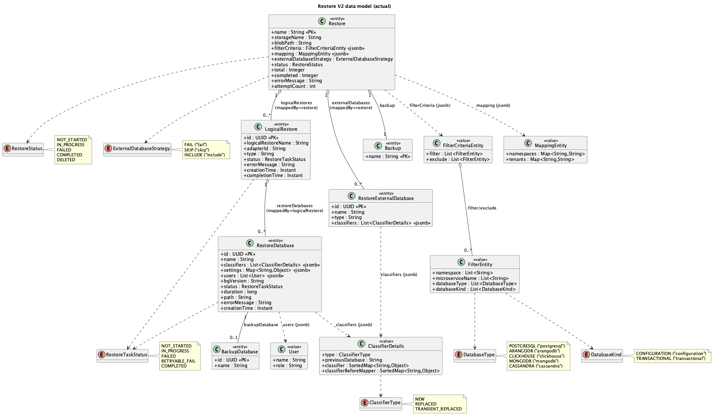

Source: [`restore-v2-data-model.puml`](../diagrams/backup-and-restore-v2/restore-v2-data-model.puml)

#### Restore

Represents a restore operation created from a backup, including the selected databases (logical and external),
mapping/filtering applied, current status, and aggregated progress statistics.

| Field                    | Type                          | Description                                                                                            | Source                                  |
|--------------------------|-------------------------------|--------------------------------------------------------------------------------------------------------|-----------------------------------------|
| name                     | String                        | Unique name of the restore                                                                             | RestoreRequest.restoreName              |
| backup                   | Backup                        | Reference to parent backup entity (one-to-one relation)                                                | -                                       |
| storageName              | String                        | Name of the storage backend containing the restore                                                     | RestoreRequest.storageName              |
| blobPath                 | String                        | Path to the restore file in the storage                                                                | RestoreRequest.blobPath                 |
| filterCriteria           | FilterCriteriaEntity (jsonb)  | Filter criteria                                                                                        | RestoreRequest.filterCriteria           |
| mapping                  | MappingEntity (jsonb)         | Mapping to use for the restore operation                                                               | RestoreRequest.mapping                  |
| logicalRestores          | List<LogicalRestore>          | List of logical restores                                                                               | -                                       |
| externalDatabaseStrategy | ExternalDatabaseStrategy      | How to handle external databases during restore                                                        | RestoreRequest.externalDatabaseStrategy |
| externalDatabases        | List<RestoreExternalDatabase> | List of external databases                                                                             | -                                       |
| status                   | RestoreStatus                 | Current state of the restore operation                                                                 | -                                       |
| total                    | Integer                       | Total number of databases being restored                                                               | -                                       |
| completed                | Integer                       | Completed databases restore operation                                                                  | -                                       |
| errorMessage             | String                        | Aggregated error messages during restore operation                                                     | -                                       |
| attemptCount             | int                           | Number of tracking/aggregation attempts made for this restore (used by the scheduler to limit retries) | —                                       |

#### LogicalRestore

Represents a per-adapter restore task within a restore operation, containing the grouped restore databases,
adapter identifiers, and the current status/progress of that logical restore. It is created during restore
initialization by grouping backup databases by target adapter and logical backup name.

| Field              | Type                  | Description                                                          |
|--------------------|-----------------------|----------------------------------------------------------------------|
| id                 | UUID                  | Auto-generated primary key                                           |
| logicalRestoreName | String                | Name of the logical restore in adapter                               |
| restore            | Restore               | Parent restore operation that this logical restore belongs to        |
| adapterId          | String                | Unique identifier of the adapter                                     |
| type               | String                | Type of the adapter                                                  |
| restoreDatabases   | List<RestoreDatabase> | List of logical restore databases                                    |
| status             | RestoreTaskStatus     | Current state of the restore operation                               |
| errorMessage       | String                | Information about error message during restore process               |
| creationTime       | Instant               | Aggregated information about creation time of databases in adapter   |
| completionTime     | Instant               | Aggregated information about completion time of databases in adapter |

#### RestoreExternalDatabase

Represents an externally managed database included in a restore operation, created during restore initialization
after applying external database strategy and filter/mapping rules.

| Field       | Type                    | Description                                                     |
|-------------|-------------------------|-----------------------------------------------------------------|
| id          | UUID                    | Auto-generated primary key                                      |
| restore     | Restore                 | Parent restore operation that this external database belongs to |
| name        | String                  | Name of the external database                                   |
| type        | String                  | Type of the database                                            |
| classifiers | List<ClassifierDetails> | Classifier objects describing database attributes               |

#### RestoreDatabase

Represents a single database being restored within a logical restore, including its classifiers, settings, users,
and status. It is created during restore initialization from a backup database and mapping/filtering results.

| Field          | Type                    | Description                                                                                             |
|----------------|-------------------------|---------------------------------------------------------------------------------------------------------|
| id             | UUID                    | Auto-generated primary key                                                                              |
| logicalRestore | LogicalRestore          | Parent logical restore that this database entry belongs to                                              |
| backupDatabase | BackupDatabase          | Source backup database used for restore                                                                 |
| name           | String                  | Name of the database                                                                                    |
| classifiers    | List<ClassifierDetails> | List of classifier details; each item contains classifier metadata and a sorted map in field classifier |
| settings       | Map<String,Object>      | Database settings as a key-value map                                                                    |
| users          | List<User>              | List of database users                                                                                  |
| bgVersion      | String                  | Blue-Green version of database                                                                          |
| status         | RestoreTaskStatus       | Current state of the restore database                                                                   |
| duration       | long                    | Duration of the restore operation                                                                       |
| path           | String                  | Path to the restore file in the storage                                                                 |
| errorMessage   | String                  | Error message if the restore failed                                                                     |
| creationTime   | Instant                 | Timestamp when the restore was created                                                                  |

#### MappingEntity

Encapsulates the namespace/tenant mapping applied during restore initialization to transform classifiers from the
backup into target values.

| Field      | Type               | Description                                     |
|------------|--------------------|-------------------------------------------------|
| namespaces | Map<String,String> | Mapping of source namespace to target namespace |
| tenants    | Map<String,String> | Mapping of source tenant to target tenant       |

#### ClassifierDetails

Represents a classifier used to identify a logical database, including its current and original key-value maps,
role in mapping (NEW / REPLACED / TRANSIENT_REPLACED), and optional link to a previous database.

| Field                  | Type                     | Description                                                                                                                                                         |
|------------------------|--------------------------|---------------------------------------------------------------------------------------------------------------------------------------------------------------------|
| type                   | ClassifierType           | Classifier role in restore mapping (NEW / REPLACED / TRANSIENT_REPLACED), indicating how this classifier is treated during restore                                  |
| previousDatabase       | String                   | Name of the existing database previously associated with this classifier, used when the classifier replaces or transiently replaces another database during restore |
| classifier             | SortedMap<String,Object> | Classifier key-value map (namespace, microservice name, tenant, etc.) that identifies a logical database instance                                                   |
| classifierBeforeMapper | SortedMap<String,Object> | Original (pre-mapping) classifier key-value map preserved to track how mapping changed the classifier during restore                                                |

## Sequence Diagrams

Below are sequence diagrams for the main Backup & Restore V2 processes. Steps that are already clear from the
diagrams are not described separately.

### Start Backup

Starts an asynchronous backup operation for the specified databases and returns a BackupResponse; returns 200 if
the backup is already completed/failed, otherwise 202. It can be invoked in dryRun mode, in which case no state
mutations or persistence occur.

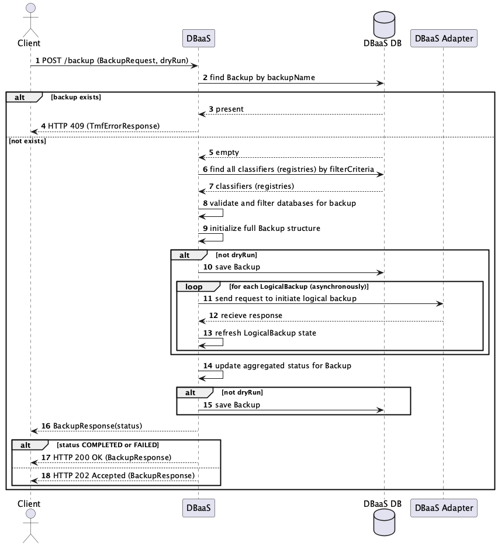

Source: [`start-backup-sequence.puml`](../diagrams/backup-and-restore-v2/start-backup-sequence.puml)

**Step 7:** Loads all registries from the repository using the filter, then filters them by removing invalid ones
(marked for drop or not in the CREATED state) and any that match a filled exclude filter
(namespace/microservice/type/kind). If nothing remains, it throws an exception that the database list is empty.

**Step 8:** Validates and filters the databases for backup. Splits them into external vs internal, applies
ExternalDatabaseStrategy (FAIL throws, SKIP excludes, INCLUDE keeps), then detects non-backupable internal DBs
(backupDisabled=true or the adapter does not support backup/restore). If ignoreNotBackupableDatabases is false it
throws; otherwise it removes them. The result is internal DBs (minus non-backupable) plus external DBs only when
the strategy is INCLUDE.

**Step 9:** Builds the full in-memory Backup structure from the filtered DBs and request: creates the base Backup,
splits databases into internal/external, groups internal ones by DBaaS Adapter identifier into LogicalBackup
objects with BackupDatabase entries, builds BackupExternalDatabase entries for externals, sets both lists on the
Backup, and returns it.

**Step 13:** Updates a LogicalBackup from the adapter response: sets logical backup ID, status, error message,
creation/completion times, then maps each returned database by name and updates the matching BackupDatabase with
status, size, duration, creation time, path, and error message.

**Step 14:** Aggregates the overall Backup status and metrics from all LogicalBackup and BackupDatabase entries:
collects logical backup statuses, sums DB count and size, counts completed DBs, gathers/logs error messages, then
sets backup.status, size, total, completed, and errorMessage accordingly.

### Check Backup Async

Periodically scans backups that need processing, tracks corresponding logical backups via adapters, updates
aggregated status/attempts, and persists the results.

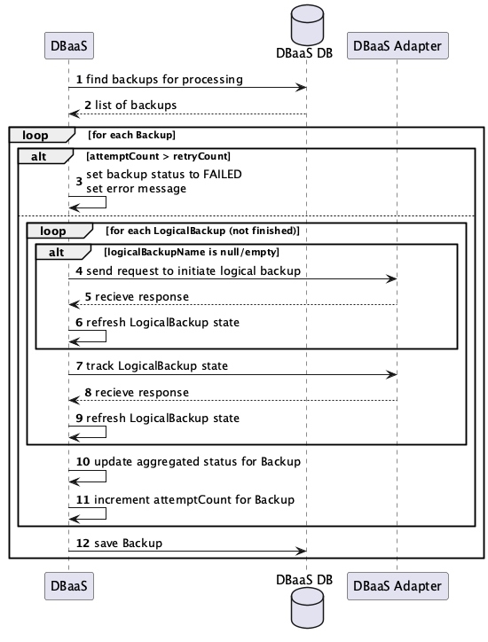

Source: [`check-backup-async-sequence.puml`](../diagrams/backup-and-restore-v2/check-backup-async-sequence.puml)

**Step 1:** Returns all Backup entities whose status is IN_PROGRESS.

**Steps 6,9:** Updates a LogicalBackup from the adapter response: sets logical backup ID, status, error message,
creation/completion times, then maps each returned database by name and updates the matching BackupDatabase with
status, size, duration, creation time, path, and error message.

**Step 10:** Aggregates the overall Backup status and metrics from all LogicalBackup and BackupDatabase entries:
collects logical backup statuses, sums DB count and size, counts completed DBs, gathers/logs error messages, then
sets backup.status, size, total, completed, and errorMessage accordingly.

### Start Restore

Initiates an asynchronous restore from an existing backup and returns a RestoreResponse; returns 200 if the restore
is already completed/failed, otherwise 202. Supports dryRun mode to validate the restore path without mutating
state or persisting changes.

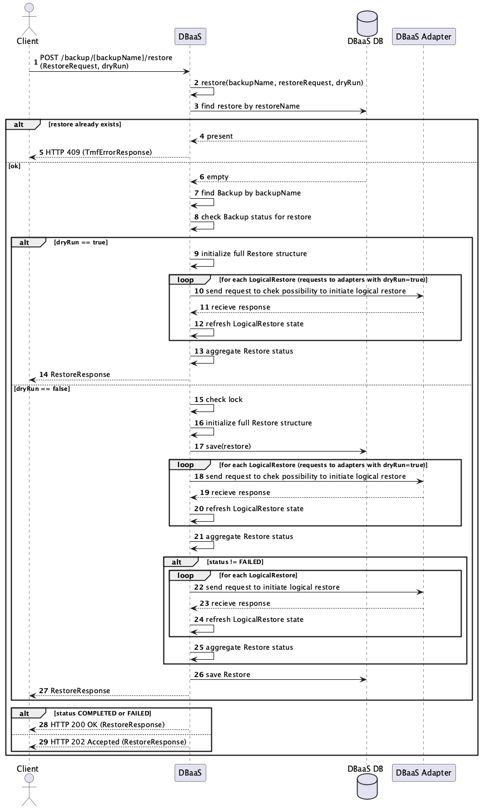

Source: [`start-restore-sequence.puml`](../diagrams/backup-and-restore-v2/start-restore-sequence.puml)

**Step 8:** Validates that a restore can proceed: if the Backup status is not COMPLETED, it logs an error and
throws an exception with a message indicating the Backup status. Otherwise it does nothing.

**Steps 9,16:** Builds a full Restore from the Backup and RestoreRequest: filters external databases by strategy
and filter criteria, filters internal backup databases by filter criteria, throws an exception if nothing matches,
applies mapping to both internal and external classifiers and checks for collisions, enriches classifiers, groups
internal databases by target adapter/logical backup key, creates LogicalRestore and RestoreDatabase entries, then
constructs the Restore (name, backup, storage, blob path, strategy, mapping, filter criteria), wires relations,
logs a summary, and returns the initialized object.

**Steps 12,20,24:** Updates a LogicalRestore from the adapter response: sets restore ID, status, error,
creation/completion times, then for each returned DB updates the matching RestoreDatabase (by previous DB name)
with status, duration, path, error, creation time, and possibly a new name. If a returned DB is not found in the
current restore list, it logs a warning and marks the logical restore as FAILED with an error message.

**Steps 13,21,25:** Aggregates overall restore status and metrics: collects LogicalRestore statuses, counts total
and completed restore databases, gathers/logs error messages, then sets restore.status, total, completed, and
errorMessage (and logs the aggregated result).

**Step 15:** Ensures only one restore runs at a time. It acquires a lock, rejects the operation if another restore
is already in progress, runs the supplied action, and always releases the lock at the end.

### Check Restore Async

Periodically scans restores that need processing (those with status IN_PROGRESS), tracks in-progress logical
restores via adapters, updates aggregated status/attempts, and persists the results; once completed, it ensures
users and initializes logical databases.

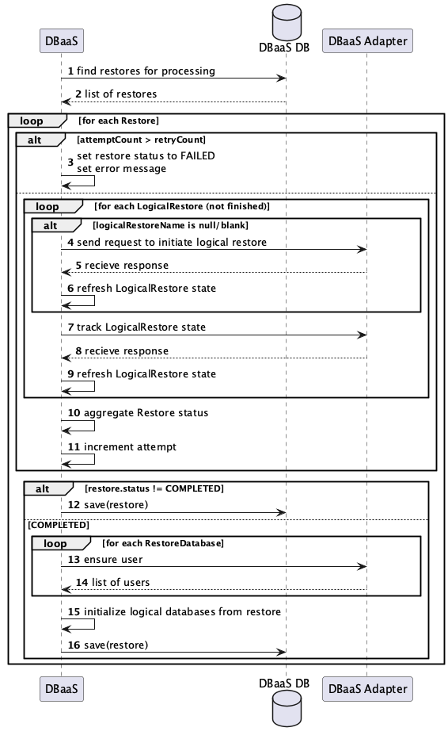

Source: [`check-restore-async-sequence.puml`](../diagrams/backup-and-restore-v2/check-restore-async-sequence.puml)

**Step 1:** Returns all Restore entities with status IN_PROGRESS.

**Steps 6,9:** Updates a LogicalRestore from the adapter response: sets restore ID, status, error,
creation/completion times, then updates each matching RestoreDatabase (by previous DB name) with status, duration,
path, error, creation time, and new name if changed. If a returned DB is not found, it marks the logical restore
as FAILED with an error.

**Step 10:** Aggregates overall restore status and metrics: collects LogicalRestore statuses, counts total and
completed restore databases, gathers/logs error messages, then sets restore.status, total, completed, and
errorMessage.

**Step 13:** Makes sure all required users exist in the target database by calling the adapter for each user (with
retries). It logs progress and returns the list of ensured users; if any user cannot be ensured, it throws an
error.

**Step 15:** Creates logical databases based on a completed restore. For each restored internal database it marks
any replaced DBs as orphans, creates a new logical DB with classifiers/settings/users, fills connection
properties/resources, encrypts credentials, and saves it. For each restored external DB it creates a corresponding
logical DB and saves it. Finally it marks the restore as COMPLETED.

### Retry Restore

Retries a failed restore operation by resetting/marking its logical restores for retry and returning 202 with the
updated RestoreResponse; only allowed when the restore status is FAILED.

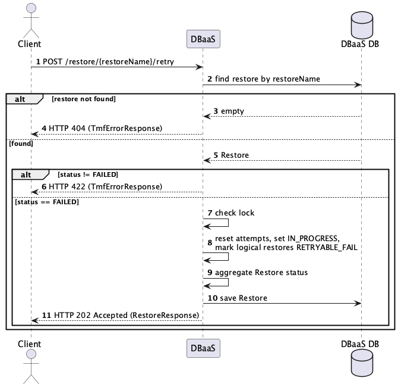

Source: [`retry-restore-sequence.puml`](../diagrams/backup-and-restore-v2/retry-restore-sequence.puml)

**Step 7:** Ensures only one restore runs at a time. It acquires a lock, rejects the operation if another restore is
already in progress, runs the supplied action, and always releases the lock at the end.

**Step 9:** Aggregates overall restore status and metrics: collects LogicalRestore statuses, counts total and
completed restore databases, gathers/logs error messages, then sets restore.status, total, completed, and
errorMessage.

### Get Backup Metadata

Returns backup metadata and a SHA-256 Digest header for a completed backup; if the backup is not in COMPLETED
status it responds with 422.

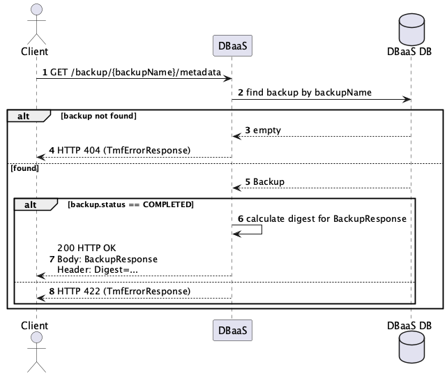

Source: [`get-backup-metadata-sequence.puml`](../diagrams/backup-and-restore-v2/get-backup-metadata-sequence.puml)

**Step 6:** Serializes the BackupResponse object to deterministic JSON, hashes it with SHA-256, encodes the hash in
Base64, and returns a string like `SHA-256=<base64>`.

### Upload Backup Metadata

Uploads backup metadata with a required SHA-256 Digest header, validates the digest, and either imports the backup
or restores a previously deleted imported backup to COMPLETED; responds with 409 for an invalid state.

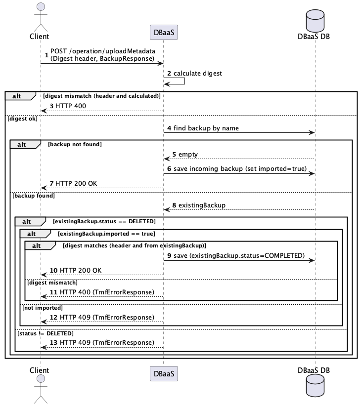

Source: [`upload-backup-metadata-sequence.puml`](../diagrams/backup-and-restore-v2/upload-backup-metadata-sequence.puml)

**Step 2:** Serializes the BackupResponse object to deterministic JSON, hashes it with SHA-256, encodes the hash in
Base64, and returns a string like `SHA-256=<base64>`.

### Delete Backup

Deletes a backup by name: if force=false it marks the backup as DELETED, otherwise it starts adapter-side deletion
and returns 202; only COMPLETED / FAILED / DELETED statuses are allowed.

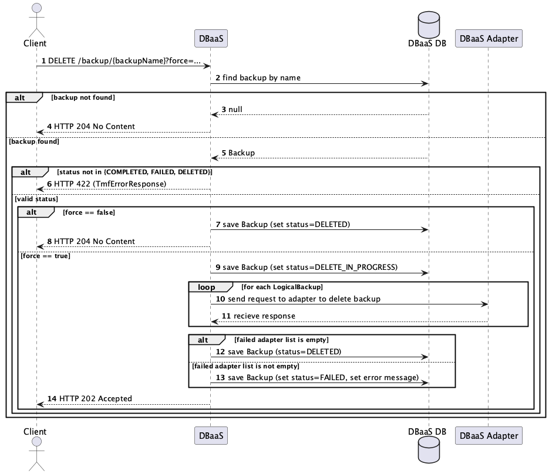

Source: [`delete-backup-sequence.puml`](../diagrams/backup-and-restore-v2/delete-backup-sequence.puml)

## State Diagrams

### Backup

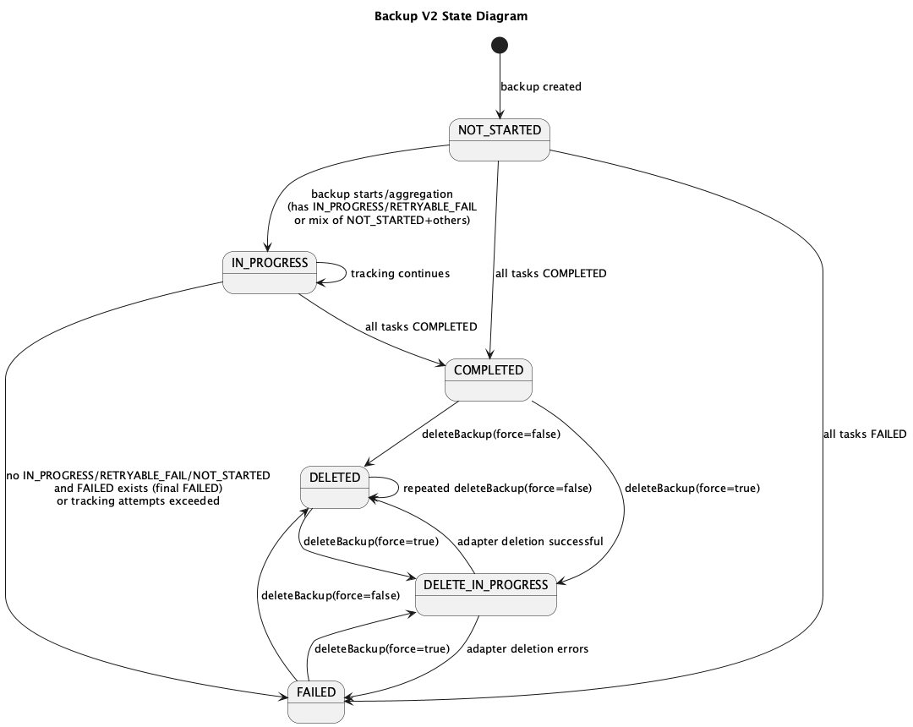

Source: [`backup-v2-state.puml`](../diagrams/backup-and-restore-v2/backup-v2-state.puml)

### Restore

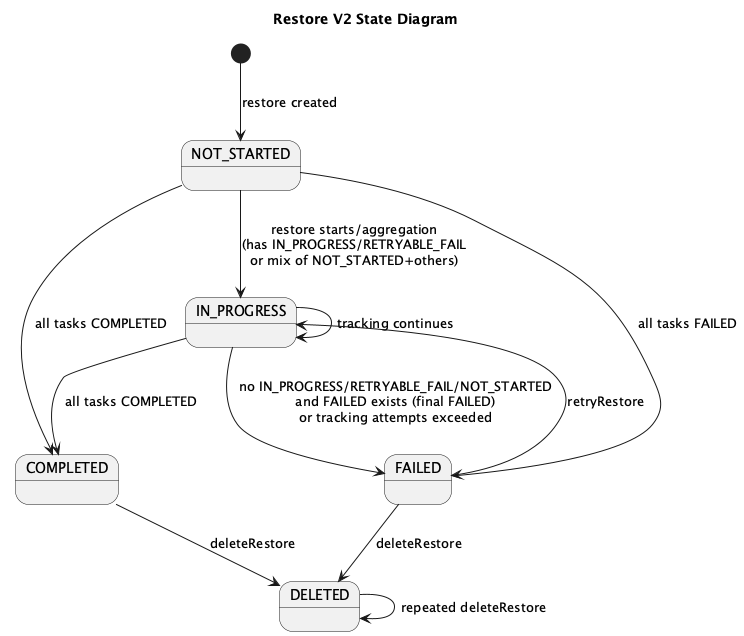

Source: [`restore-v2-state.puml`](../diagrams/backup-and-restore-v2/restore-v2-state.puml)

## Requirements for adapters

The Backup & Restore V2 endpoints defined by the [adapter contract](../api/adapter-contract.yaml):

| Operation        | Endpoint                                                                            | Used for                                                                             |
|------------------|-------------------------------------------------------------------------------------|--------------------------------------------------------------------------------------|
| `backupV2`       | `POST /api/v2/dbaas/adapter/{type}/backups/backup`                                  | Start the backup of a group of databases (`storageName`, `blobPath`, database names) |
| `trackBackupV2`  | `GET /api/v2/dbaas/adapter/{type}/backups/backup/{backupId}?storageName&blobPath`   | Track the backup group                                                               |
| `deleteBackupV2` | `DELETE /api/v2/dbaas/adapter/{type}/backups/backup/{backupId}?blobPath`            | Delete the payload on `force=true`                                                   |
| `restoreV2`      | `POST /api/v2/dbaas/adapter/{type}/backups/backup/{backupId}/restore?dryRun`        | Start the restore of a group; `dryRun` validates without applying                    |
| `trackRestoreV2` | `GET /api/v2/dbaas/adapter/{type}/backups/restore/{restoreId}?storageName&blobPath` | Track the restore group                                                              |
| `ensureUser`     | `PUT /api/v2/dbaas/adapter/{type}/users/{username}`                                 | Ensure the restored users exist in the target databases after completion             |

An adapter also declares through registration whether it supports backup/restore; an adapter without the capability
excludes its databases from backups (the `backupRestore` flag of the physical database registration).

Behavioral requirements:

- **Payload location.** The adapter and the Backup Daemon store and read the payload in the S3-compatible storage
  named by `storageName` and `blobPath` from the request. The aggregator never touches the payload.
- **Restore naming.** The adapter generates the name of each restored database and reports both names per database
  in the initial and tracking responses (`LogicalRestoreAdapterResponse`): `databaseName` is the name the database
  was restored under, `previousDatabaseName` is the name the database had in the backup. The target environment may
  already contain a database with the original name, so the name cannot be chosen by the caller.
- **Dry run.** `restoreV2` with `dryRun=true` validates the restore (payload reachable, databases restorable) and
  returns the calculated result without applying changes. The aggregator runs this pass for every logical restore
  before the real restore and aborts the restore if it fails.
- **Tracking.** `trackBackupV2` / `trackRestoreV2` return the per-database status (`status`, `size`, `duration`,
  `path`, `creationTime`, `errorMessage`) for every database of the group. A database the aggregator asked for but
  that is absent from the response marks the logical operation `FAILED`.
- **Completion.** The group is `COMPLETED` only when every database of it is completed; a failure of any database
  must be visible in the group status or in the per-database `errorMessage`.

## Requirements for the aggregator

The implementation follows the [aggregator guidelines](aggregator.md): a layered controller-service-repository
design, transactions at the service level, adapter calls through a REST client, and typed error responses mapped
to HTTP status codes.

Specific to Backup & Restore V2:

- **Multi-step work and scheduling.** Backup and restore run as asynchronous operations over a dedicated thread
  pool; the periodic tracking runs on a schedule with a distributed lock, so one replica runs each pass. Delete
  with `force=true` runs adapter-side deletions in parallel and aggregates the failures.
- **Aggregation.** Every adapter response (initial, tracking, retry) is followed by an aggregation pass that
  recomputes the operation status and the `total`/`completed`/`size`/`errorMessage` fields from the per-database
  entries.
- **Digest.** The backup metadata digest is computed over deterministic JSON (properties and map entries sorted
  alphabetically, dates as ISO strings): SHA-256 of the UTF-8 bytes, Base64-encoded, formatted as
  `SHA-256=<base64>`. Upload recomputes the digest over the received body and rejects the request with 409 on
  mismatch.
- **Metadata import.** `uploadMetadata` creates a new backup with `imported=true` when the name is unknown. When
  the name exists and the existing backup is a `DELETED` imported one, an identical digest returns it to
  `COMPLETED`; a different digest, a `DELETED` non-imported backup, or any non-`DELETED` state is rejected with 409.
- **Persistence.** Operation state is persisted in PostgreSQL; the database registry reads that feed the selection
  come from the H2 mirror, per the general aggregator rules.

## Configuration

| Parameter                                  | Environment variable                       | Default | Description                                                                                                                   |
|--------------------------------------------|--------------------------------------------|---------|-------------------------------------------------------------------------------------------------------------------------------|
| `dbaas.backup-restore.check.interval`      | `DBAAS_BACKUP_RESTORE_CHECK_INTERVAL`      | `1m`    | Interval for periodic backup/restore status checks.                                                                           |
| `dbaas.backup-restore.check.attempts`      | `DBAAS_BACKUP_RESTORE_CHECK_ATTEMPTS`      | `20`    | Max number of tracking attempts before marking backup/restore as `FAILED`.                                                    |
| `dbaas.backup-restore.retry.delay.seconds` | `DBAAS_BACKUP_RESTORE_RETRY_DELAY_SECONDS` | `3`     | Delay between adapter retry attempts.                                                                                         |
| `dbaas.backup-restore.retry.attempts`      | `DBAAS_BACKUP_RESTORE_RETRY_ATTEMPTS`      | `3`     | Max number of adapter retry attempts.                                                                                         |
| `shedlock.defaults.lock-at-most-for`       | `DBAAS_BACKUP_RESTORE_CHECK_LOCK_TIMEOUT`  | `PT10M` | Max lock holding time for schedulers.                                                                                         |
| `backup.aggregator.async.thread.pool.size` | `BACKUP_AGGREGATOR_ASYNC_THREAD_POOL_SIZE` | `10`    | Thread pool size for async backup/restore operations. Not exposed by the Helm chart; set as a container environment variable. |

The first five parameters are documented in the
[installation parameters](../installation/parameters.md).
